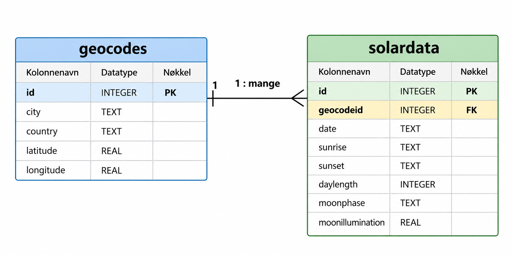

# Solar Data SQL Analysis

A relational database project built with SQLite and DB Browser for SQLite.

The project uses geographic and solar data to demonstrate database design, primary and foreign keys, CSV data import, and SQL joins.

## Dataset

The database contains two related tables:

* "geocodes" – geographic information for five cities
* "solardata" – daily solar and lunar data for the same cities during 2025

The dataset contains:

- 5 locations
- 1,825 solar data records
- 365 daily records per city

## Database relationship

The tables are connected through a one to many relationship:

"geocodes.id" → "solardata.geocodeid"



## SQL joins

The project includes both inner and outer table joins.

### INNER JOIN

The INNER JOIN connects solar data records with the corresponding city.

```sql
SELECT
    solardata.date,
    geocodes.city,
    solardata.sunrise,
    solardata.sunset,
    solardata.daylength
FROM solardata
INNER JOIN geocodes
    ON solardata.geocodeid = geocodes.id
LIMIT 10;
